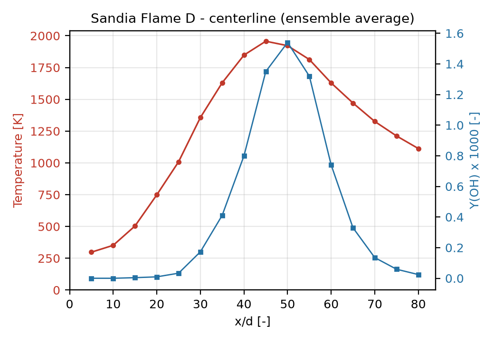
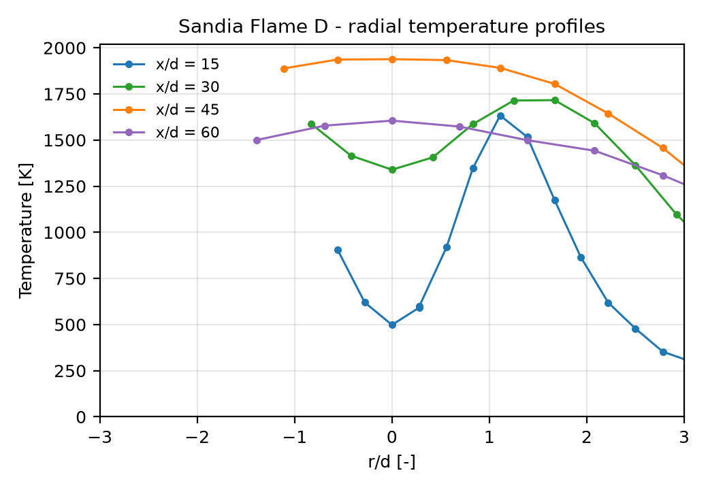

# cfd-portfolio

面向家电 / 燃烧 CFD 场景的仿真作品集。每个项目都走完整链路：
**几何 → 网格 → 模型选型 → 与公开实验/解析解对标 → 误差量化**。

不是"我跑过哪些软件"，而是"我的计算结果与已知答案差多少，为什么差"。

---

## 项目进度

| # | 项目 | 对标依据 | 关键指标 | 状态 |
|---|------|----------|----------|------|
| 01 | 圆管层流（Poiseuille） | 解析解、f = 64/Re | 速度剖面 / 压降误差 < 1% | ⬜ 未开始 |
| 02 | 后台阶流动 | Armaly 1983；Driver & Seegmiller 1985 | 再附着长度 x/H 误差 ≤ 10% | ⬜ 未开始 |
| 03 | **Sandia Flame D 湍流燃烧** | TNF Workshop 实验数据 | 轴向温度误差 < 15% | 🔵 数据已就绪 |

> 状态图例：⬜ 未开始 · 🔵 进行中 · ✅ 已完成

---

## 仓库结构

```text
cfd-portfolio/
├─ README.md                 本文件：作品集主页
├─ data/
│  ├─ README.md              数据来源、引用、字段说明（必读）
│  ├─ raw/                   原始存档（.gitignore，脚本自动下载）
│  └─ processed/             整理好的 CSV（已提交，可直接用 Excel/Origin 打开）
├─ scripts/
│  ├─ fetch_flameD.py        一键下载 TNF Flame D 数据
│  ├─ flamed_io.py           数据格式解析器（纯标准库）
│  ├─ probe_flamed.py        数据体检 + 边界条件速查
│  ├─ export_flamed_csv.py   导出整洁 CSV
│  └─ plot_flamed.py         生成参考数据图
├─ docs/figures/             报告中引用的图
├─ projects/
│  ├─ 01-pipe-laminar/
│  ├─ 02-backward-facing-step/
│  └─ 03-sandia-flamed/
└─ requirements.txt
```

---

## 数据：Sandia Flame D（TNF Workshop）

TNF Workshop 的数据**不需要注册、不需要登录**，是公开直链。仓库用脚本复现，
不把 8 MB 的原始压缩包塞进 git 历史：

```bash
python -m pip install -r requirements.txt
python scripts/fetch_flameD.py --extract   # 下载并解压到 data/raw/
python scripts/probe_flamed.py             # 体检 + 打印工况
python scripts/export_flamed_csv.py        # 导出 data/processed/*.csv
python scripts/plot_flamed.py              # 生成 docs/figures/*.png
```

下载内容（Release 2.0, 2003-01）：

| 文件 | 内容 |
|------|------|
| SandiaPilotDoc21.pdf | 实验文档：构型、边界条件、不确定度 |
| pmCDEF.zip | 火焰 C/D/E/F 标量数据（Raman/Rayleigh/LIF） |
| LongRecordsFlameD.zip | Flame D 长序列单点数据 |
| TUD_LDV_DEF.zip | TUD LDV 速度数据 |

### Flame D 工况（建模时必须对齐）

| 参数 | 值 |
|------|-----|
| 燃料射流喷嘴直径 | d = 7.2 mm |
| 值班火焰（pilot）外径 | 18.2 mm |
| 燃料组成 | 25% CH4 + 75% air（体积） |
| 化学当量比 F_stoic | 0.351 |
| 射流出口体均速度 | U = 49.6 m/s |
| 雷诺数 | Re = 22 400 |
| 可见火焰长度 | L_vis ≈ 67 d |
| pilot 当量比 | φ = 0.77 |

### 参考数据图





把 Fluent / OpenFOAM 的计算结果叠加到这两张图上，就是标准的"文献对标图"。

---

## 方法：我的 V&V 流程

1. **先定对标依据**：解析解 > 基准实验（有不确定度）> 别人的仿真。开工前写下"什么算通过"。
2. **网格无关性**：三套网格（约 2 倍逐级加密），报告里给 Δ（关键量对网格的敏感度），而不是只给"最后用了 200 万网格"。
3. **边界条件可追溯**：每个算例列出流入条件、湍流强度/水力直径、壁面处理，注明来源（实验文档 or 估算）。
4. **误差量化**：不只画图叠在一起，要给出定量指标（相对误差、L2 范数、峰值位置偏差）。
5. **解释偏差**：模型局限（如 RANS 对局部熄火的失效）、边界条件不确定性、测量不确定度——这一节最能体现对模型的理解。

---

## 引用

使用本仓库数据请引用原始文献：

- Barlow, R. S. and Frank, J. H., *Proc. Combust. Inst.* **27**:1087–1095 (1998).
- Barlow, R. S., Frank, J. H., Karpetis, A. N., Chen, J.-Y., *Combust. Flame* **143**:433–449 (2005).
- Schneider, Ch., Dreizler, A., Janicka, J., *Combust. Flame* **135**:185–190 (2003).

数据来源：TNF Workshop, <https://tnfworkshop.org/data-archives/pilotedjet/ch4-air/>

## 许可

代码与文档：MIT（见 LICENSE）。`data/` 下实验数据版权归原始测量者，仅限科研与验证用途。
